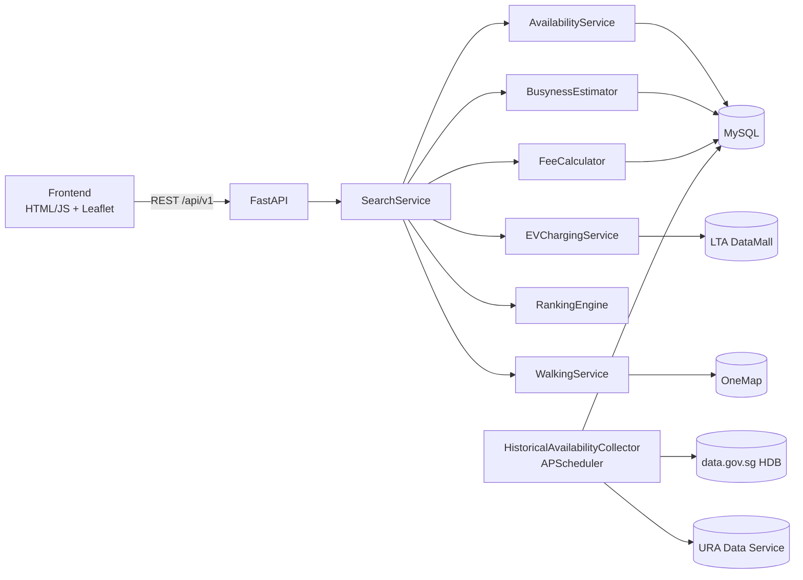

# Best Carpark

[](https://github.com/classy-j/best-carpark/actions/workflows/ci.yml)

Find the best carpark near your destination in Singapore. Enter where you're going and how
long you'll stay; Best Carpark looks at every supported carpark within 1 km and ranks them by
what matters to you: estimated fee, walking time, live availability, expected busyness at your
arrival time, carpark type, and EV charging.

Built by a team of five for **SC2006 Software Engineering** at Nanyang Technological University
(AY2026/27), using Singapore government open data.

## Demo

[](https://youtu.be/MD-oEodFP5Y)

▶ [Watch the demo on YouTube](https://youtu.be/MD-oEodFP5Y)

## Features

- **Fee estimation** from HDB and URA published rate rules, including night caps, daily caps,
  per-entry charges and Central Area rates, walked minute by minute across the stay
- **Live availability** from data.gov.sg (HDB) and URA
- **Expected busyness** at arrival time, from the average occupancy in the same weekday and
  15-minute slot over the past 8 weeks of collected history
- **Preference-weighted ranking**: the driver orders their priorities; each one gets a
  decaying weight (1, 0.6, 0.36, ...), and missing data for a carpark neither helps nor hurts
- **Verified walking routes** via OneMap
- **EV charging** availability from LTA DataMall
- **Background data collector** that polls availability every 10 minutes, backfills past
  snapshots so estimates work from day one, and refreshes carpark and EV data daily/hourly

## Architecture



The design follows the course's entity / boundary / control model; the full class diagram and
dialog map are in [`docs/diagrams/`](docs/diagrams).

## My role

I was the **team lead** and owned the **database, persistence and historical data collection**
layer:

- MySQL schema and SQLAlchemy data layer (`backend/sql/`, `backend/app/db/`,
  `backend/app/repositories/`)
- `HistoricalAvailabilityCollector`: scheduled polling, backfill from data.gov.sg snapshots,
  daily carpark refresh (`backend/app/collectors/`)
- HDB rate seeding and the URA carpark + rate integration
- EV charging integration with the database
- Black-box and basis-path (white-box) test suites

I also wrote the functional and non-functional requirements and the design class model for the
project's analysis and design phases.

### Team

| Member | Area |
| --- | --- |
| Jiratip Jedmongkolrat | Database, persistence, data collection; team lead |
| Sean Lee Jan See | Parking fee calculation and ranking |
| Lim Jie | Search, OneMap, aggregation and backend orchestration |
| Wang Hong Qi, Ernest | Live availability, EV charging and busyness |
| Mundhra Jash | Frontend and frontend–backend integration |

## Getting started

Requires Python 3.11+, MySQL 8, and free API access for
[OneMap](https://www.onemap.gov.sg/apidocs/), [LTA DataMall](https://datamall.lta.gov.sg/)
and URA Data Service (URA and LTA are optional).

```bash
docker compose up -d db                   # or use your own MySQL 8

cd backend
pip install -r requirements.txt
cp .env.example .env                      # fill in DB and OneMap credentials

python -m app.collectors.load_carparks    # load HDB carparks
python -m app.collectors.seed_rates       # load HDB parking rates
python -m app.collectors.run_collector --backfill 28   # optional: 4 weeks of history
uvicorn app.main:app --reload             # API on http://localhost:8000, docs at /docs
```

Run the collector continuously with `python -m app.collectors.run_collector`, and serve
`frontend/` with any static server (e.g. `python -m http.server 5500 -d frontend`).
More detail in [`backend/README.md`](backend/README.md) and [`docs/DATABASE.md`](docs/DATABASE.md).

### Tests

```bash
cd backend && python -m pytest
```

134 tests: unit tests for every service plus database tests that run against a throwaway
`carpark_test` schema (skipped automatically when MySQL isn't running; CI runs them all).

## Documentation

- [API specification](docs/API_SPECIFICATION.md)
- [Backend interfaces](docs/BACKEND_INTERFACES.md)
- [Database design](docs/DATABASE.md)

## Tech stack

Python · FastAPI · SQLAlchemy · MySQL · APScheduler · pytest · HTML/CSS/JavaScript · Leaflet ·
GitHub Actions

Data: data.gov.sg (HDB carpark availability) · URA Data Service · LTA DataMall · OneMap
